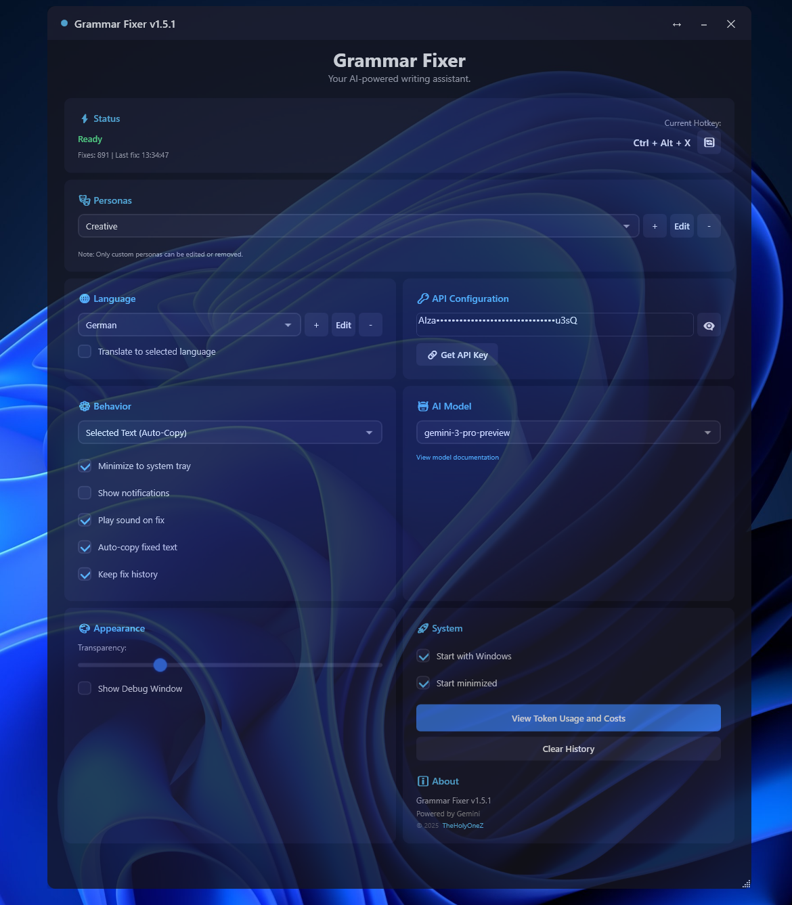
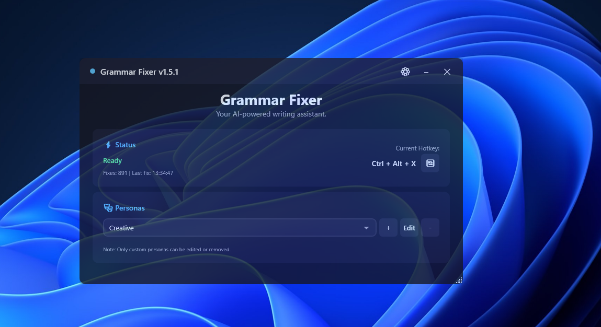
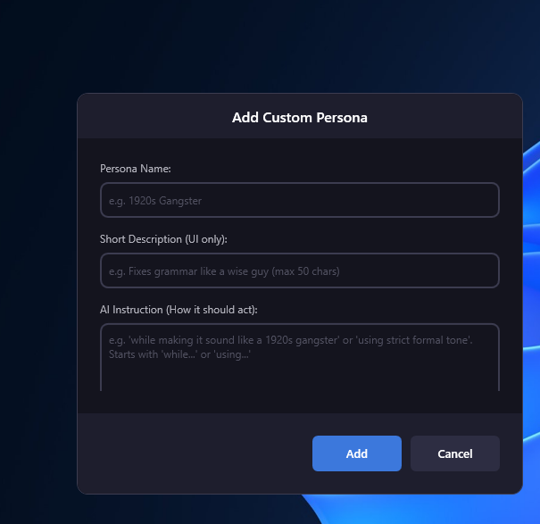
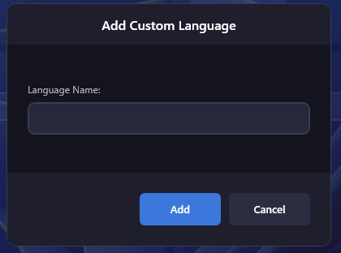
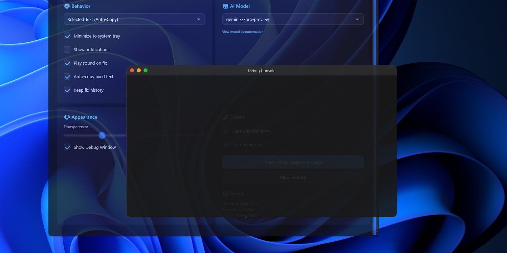

> [!IMPORTANT]
> ## This project is no longer maintained — use [**ZyntaxAI**](https://zsync.eu/zyntaxai/) instead
>
> Grammar Fixer has been **completely rebuilt** as **[ZyntaxAI](https://zsync.eu/zyntaxai/)**. It is not a
> port — it was written from scratch in Rust and TypeScript, and it does everything this did, better.
> Nothing here will receive fixes or new features.
>
> | | Grammar Fixer (this) | [ZyntaxAI](https://zsync.eu/zyntaxai/) |
> |---|---|---|
> | **Platforms** | Windows only | **Windows, Linux and macOS** |
> | **AI provider** | Gemini, hardcoded | **Gemini, any OpenAI-compatible endpoint, or local Ollama** |
> | **Works offline** | No | **Yes — with Ollama, your text never leaves the machine** |
> | **Before it edits your text** | Applied blind | **A word-level diff you approve first** |
> | **Writing styles** | 5 personas | 5 personas **plus your own** |
> | **Languages** | Target language | 13 built-in **plus your own**, with optional translation |
> | **Cost tracking** | One blended rate | **Per model, input and output priced separately** |
> | **API key storage** | Encrypted file | **Your OS keychain** |
> | **Updates** | Manual download | **Signed in-app updates** |
> | **Interface** | Single window | Tray, correction overlay, and a redesigned settings window |
> | **Licence** | MIT | GPL-3.0-or-later |
>
> It also fixes real bugs that were never solved here — corrections silently truncated past ~350
> words, the selected language sometimes dropped from the request, under-reported costs, and a
> clipboard that got destroyed when used as scratch space.
>
> ### → [**Download ZyntaxAI**](https://zsync.eu/zyntaxai/) · [Source on GitHub](https://github.com/TheHolyOneZ/ZyntaxAI)
>
> Everything below describes the old Windows-only version and is kept for reference only.

<div align="center">
  
  <h1>Grammar Fixer</h1>
  <p><em>Unmaintained — see <a href="https://zsync.eu/zyntaxai/">ZyntaxAI</a></em></p>
  <p><strong>An intelligent, AI-powered grammar correction tool for Windows that fixes your text with a simple hotkey. Powered by Google Gemini AI.</strong></p>
  
  <p>
    
    
    
    
  </p>
  
  <p>
    <a href="https://github.com/TheHolyOneZ/GrammarFixer/releases"><strong>Download Latest Release »</strong></a>
  </p>
</div>

---

## 📖 Table of Contents

- [✨ Features](#-features)
- [📸 Visuals](#-visuals)
- [🚀 Getting Started](#-getting-started)
- [🔧 Comprehensive Guide](#-comprehensive-guide)
  - [Main Interface](#main-interface)
  - [Advanced Settings View](#advanced-settings-view)
- [🛠️ Building from Source](#️-building-from-source)
- [🐛 Troubleshooting](#-troubleshooting)
- [🤝 Contributing](#-contributing)
- [📄 License](#-license)

---

## ✨ Features

Grammar Fixer is packed with features to make your writing process seamless and efficient.

<details>
  <summary><strong>📝 Core Functionality</strong></summary>
  
  - **🎯 Global Hotkey System**: Fix grammar in any application with a customizable keyboard shortcut.
  - **🤖 AI-Powered Corrections**: Uses Google Gemini for intelligent, context-aware grammar and spelling corrections.
  - **⚡ Multi-Speed Processing**: Choose between **Fast**, **Normal**, or **Detailed** correction modes to balance speed and thoroughness.
  - **🔄 Flexible Input & Output**: 
    - **Input**: Process text from a selection (auto-copied) or the clipboard.
    - **Output**: Replace the original text, copy the correction to the clipboard, append/prepend it, or display it in a popup.
</details>

<details>
  <summary><strong>🎨 Customization & UI</strong></summary>
  
  - **🎭 Writing Personas**: Instantly change your writing style with built-in personas, including **Standard**, **Friendly**, **Professional**, **Concise**, and **Creative**.
  - **✍️ Custom Personas**: Create, edit, and delete your own personas with unique instructions to match your desired tone.
  - **↔️ Compact & Advanced Views**: Switch between a minimalist UI and an advanced view with all settings.
  - **💧 Adjustable Opacity**: Set the window's transparency to blend with your desktop.
  - **👁️ API Key Visibility**: Toggle the visibility of your API key for privacy.
</details>

<details>
  <summary><strong>🌍 Language & Model Management</strong></summary>
  
  - **🌐 Language Support**: Automatically detects the input language for accurate corrections.
  - **🗣️ Translate & Add Languages**: Translate text to a different language, and add, edit, or remove custom languages.
  - **🧠 Selectable AI Models**: Choose the specific Gemini model you want to use.
</details>

<details>
  <summary><strong>⚙️ System Integration & Utilities</strong></summary>
  
  - **🚀 Startup Options**: Configure the app to start with Windows, either visibly or minimized to the tray.
  - **💾 System Tray Integration**: Keep the app running in the background for quick access.
  - **🔔 Feedback**: Get notifications and optional sound alerts on successful corrections.
  - **📊 Usage Statistics**: Track your total number of fixes and see when the last one was performed.
  - **📈 Token Usage Tracking**: Monitor your API token usage and estimated costs.
  - **🛠️ Debug Window**: Access a separate debug window for advanced troubleshooting.
</
details>

---

## 📸 Visuals

<div align="center">
  <h2>Main Views</h2>
  
  <p><em>Default Application View</em></p>
  
  <p><em>Compact Application View</em></p>
  
  <h2>Customization Dialogs</h2>
  
  <p><em>Custom Persona Management</em></p>
  
  <p><em>Custom Language Management</em></p>

  <h2>Debug Console</h2>
  
  <p><em>Debug Window for Troubleshooting</em></p>
</div>

---

## 🚀 Getting Started

### Prerequisites
- **OS**: Windows 10 (1809+) or Windows 11
- **Runtime**: .NET 8.0 Runtime ([Download](https://dotnet.microsoft.com/download/dotnet/8.0))
- **API Key**: Google Gemini API Key ([Get one for free](https://aistudio.google.com/app/apikey))

### Installation
1.  Go to the [**Releases**](https://github.com/TheHolyOneZ/GrammarFixer/releases) page.
2.  Download the latest `GrammarFixer.exe`.
3.  Run the executable and enter your Gemini API key in the settings.
4.  Start fixing your text with the default hotkey `Ctrl+Alt+T`!

---

## 🔧 Comprehensive Guide

### Main Interface

The main window is designed to be intuitive, whether in its compact or advanced form.

#### Title Bar
- **Toggle Size (↔)**: Switches between the compact and advanced views.
- **Minimize (-)**: Minimizes the application. Can be configured to minimize to the system tray.
- **Close (✕)**: Exits the application.

#### Status Panel (Visible in Both Views)
- **⚡ Status**: Shows the current application state (e.g., "Ready", "Processing", "Error").
- **Fixes & Last Fix**: A quick glance at your usage statistics.
- **Current Hotkey**: Displays the active hotkey. Click the **🔄 button** to open the **Hotkey Dialog** and set a new key combination.

#### Personas Panel (Visible in Both Views)
- **🎭 Personas Dropdown**: Select the AI's writing style.
- **Manage Personas (+, Edit, -)**: Open dialogs to add, edit, or remove your **custom personas**. Note: Built-in personas cannot be modified.

### Advanced Settings View

The advanced view is organized into a bento-style grid, giving you access to all configuration options.

<details>
  <summary><strong>🌐 Language</strong></summary>
  
  - **Language Dropdown**: Select the target language for corrections or translation.
  - **Manage Languages (+, Edit, -)**: Add, edit, or remove custom languages from the list.
  - **Translate Checkbox**: When checked, the AI will translate the source text to the selected language in addition to correcting its grammar.
</details>

<details>
  <summary><strong>🔑 API Configuration</strong></summary>
  
  - **API Key Box**: Enter your Google Gemini API key here. It is saved automatically.
  - **Toggle Visibility (👁️)**: Show or hide your API key for easy copying or to protect it from shoulder-surfing.
  - **Get API Key Button**: A convenient link that opens the Google AI Studio website to get your key.
</details>

<details>
  <summary><strong>⚙️ Behavior</strong></summary>
  
  - **Input Source Dropdown**:
    - **Selected Text (Auto-Copy)**: The recommended default. Automatically copies the text you have highlighted in any application when you press the hotkey.
    - **Clipboard Content Only**: Uses the text you have manually copied to the clipboard (Ctrl+C).
  - **Checkboxes**:
    - `Minimize to system tray`: Hides the window to the tray when minimized.
    - `Show notifications`: Displays a Windows notification on success or error.
    - `Play sound on fix`: Plays a system sound upon successful correction.
    - `Auto-copy fixed text`: Automatically copies the corrected text to the clipboard.
    - `Keep fix history`: Enables tracking of usage statistics.
</details>

<details>
  <summary><strong>🤖 AI Model</strong></summary>
  
  - **Model Selection Dropdown**: Choose which Gemini model to use for corrections 
  - **View model documentation**: A hyperlink to Google's official documentation on the available models.
</details>

<details>
  <summary><strong>🎨 Appearance</strong></summary>
  
  - **Transparency Slider**: Adjust the opacity of the application window.
  - **Show Debug Window Checkbox**: Toggles a separate console window that displays detailed logs, useful for troubleshooting.
</details>

<details>
  <summary><strong>🚀 System & About</strong></summary>
  
  - **Checkboxes**:
    - `Start with Windows`: Automatically launches Grammar Fixer when you log in.
    - `Start minimized`: When combined with the above, starts the application directly in the system tray.
  - **Buttons**:
    - `View Token Usage and Costs`: Opens a detailed window to track your API usage and estimated costs over time.
    - `Clear History`: Resets your fix count and last fix statistics.
  - **About Section**: Contains the application version and a link to the author's GitHub.
</details>

---

## 🛠️ Building from Source

If you prefer to build the application yourself, follow these steps:

```bash
# Clone the repository
git clone https://github.com/TheHolyOneZ/GrammarFixer.git
cd GrammarFixer

# Build using the provided script
build.bat

# Or, build manually
dotnet restore
dotnet publish GrammarFixer\GrammarFixer.csproj -c Release -r win-x64 --self-contained true -o publish

# Run the application
cd publish
GrammarFixer.exe
```

---

## 🐛 Troubleshooting

<details>
  <summary><strong>Application Won't Start</strong></summary>
  
  - Ensure you have the [**.NET 8.0 Runtime**](https://dotnet.microsoft.com/download/dotnet/8.0) installed.
  - Check the log files in `%LOCALAPPDATA%\GrammarFixer\Logs\` for any errors.
  - Try running the application as an administrator.
</details>

<details>
  <summary><strong>Hotkey Not Working</strong></summary>
  
  - Make sure the application is running and the hotkey is not conflicting with another program.
  - Try changing the hotkey in the settings.
  - Switch the input source between "Selected Text" and "Clipboard Content".
</details>

<details>
  <summary><strong>API Errors</strong></summary>
  
  - **401 Error**: Your API key is invalid. Please verify it in the settings.
  - **429 Error**: You have exceeded your API rate limit. Wait a few minutes before trying again.
  - **500 Error**: There is an issue with the Google AI service. Please try again later.
</details>

---

## 🤝 Contributing

Contributions are welcome! Please feel free to submit a pull request or open an issue to discuss your ideas.

## 📄 License

This project is licensed under the MIT License. See the [LICENSE](LICENSE) file for details.

<div align="center">
  <p><strong>Made with ❤️ by TheHolyOneZ</strong></p>
</div>

